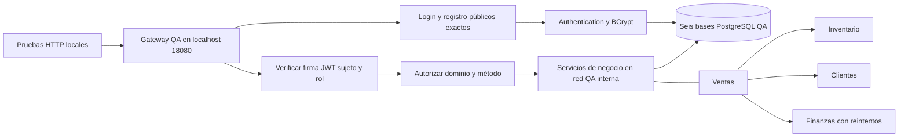
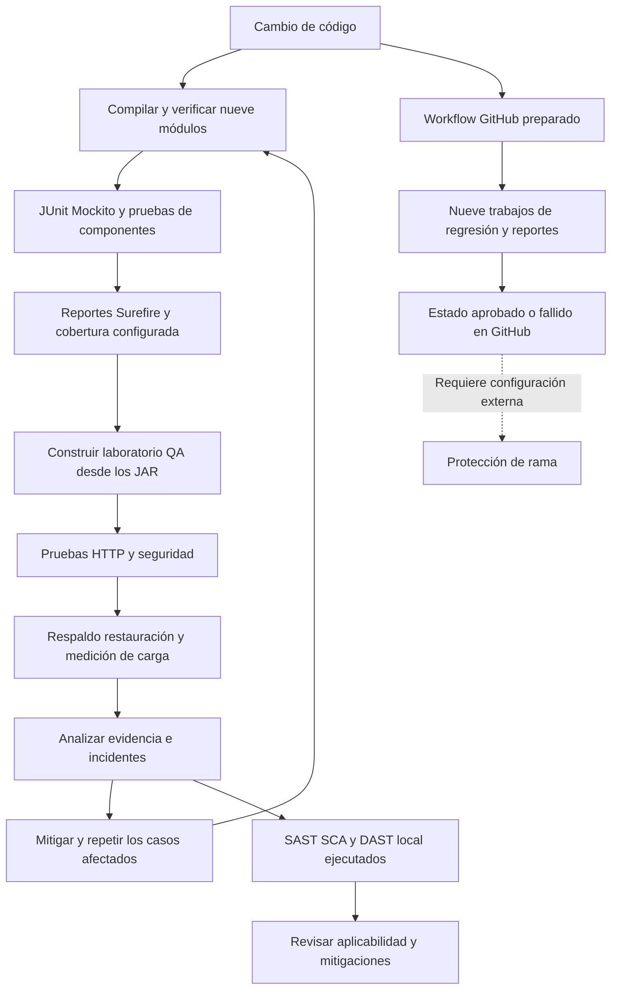

# Controles automatizados y mantenimiento del backend

Este documento desarrolla IE3 e IE7 de la rúbrica. Distingue controles implementados, resultados que requieren evidencia de ejecución y medidas propuestas para futuras versiones. Complementa el informe y no certifica cumplimiento legal.

## Flujo del backend evaluado

La lista de dominios del Gateway deniega rutas no declaradas incluso para SUPER_ADMIN. El rol conserva acceso completo sobre los dominios declarados. Las rutas públicas de autenticación son coincidencias exactas; la documentación utiliza límites de segmento. OPTIONS se conserva para preflight y su política de origen corresponde al filtro CORS separado.

El aislamiento de red del laboratorio no demuestra autenticación entre microservicios ni protege por sí solo otros despliegues que publiquen sus puertos directamente.

## Flujo de verificación

Los scripts locales automatizan las tareas representadas hasta el análisis de evidencia. El workflow de GitHub contiene la regresión Java; no incluye aún la orquestación completa del laboratorio, carga, respaldos ni los escaneos ejecutados localmente. La ejecución real en GitHub y la protección de rama deben comprobarse por separado. No hay CD implementado.

## Relación entre control requisito y evidencia

| Control | Requisito o criterio | Evidencia concreta | Límite |
| --- | --- | --- | --- |
| Firma JWT y claims válidos | NFR-SEG-4, NFR-SEG-9 y RF-3.3 | GatewayJwtSecurityTest y JwtAuthFilterSecurityTest; casos HTTP SYS-02 y SYS-04 | No implementa revocación inmediata de tokens ya emitidos. |
| Denegación por defecto y segmentos de ruta | RF-3.3, RB-4, RB-5, RB-6 y mínimo privilegio | Pruebas de rutas desconocidas, prefijos y roles; evidencia anterior y posterior | No sustituye revisar nuevos endpoints dentro de un dominio autorizado. |
| Claves externas e inicialización opcional | Gestión de credenciales y protección de datos del ERS | Configuración y DataInitializerTest, con BCrypt real | No rota credenciales utilizadas en otros ambientes. |
| Cantidades positivas antes de efectos | NFR-SEG-5 y RF-5.2 | CantidadStockTest, CantidadVentaTest y SYS-08 | No cubre todavía todos los campos de creación de productos o ventas. |
| Recurso inexistente y errores genéricos | Criterios HTTP y confidencialidad | GlobalExceptionHandlerTest y SYS-05 | Otros servicios mantienen manejos de excepción por revisar. |
| Recuperación de seis bases QA | NFR-SEG-7 | Dumps restaurados y comparación de cantidades y huellas | No acredita cifrado, almacenamiento externo, recuperación de roles o RPO/RTO productivos. |
| Medición de latencia y concurrencia | NFR-PERF-1 y NFR-PERF-3 | Muestras normales y quinientas solicitudes con cien clientes | Un endpoint de lectura, dataset pequeño y prueba breve. |
| Regresión repetible | Calidad y mantenibilidad; IE5 | Resumen por módulo, XML y códigos de salida | Cobertura de código no equivale a cobertura de requisitos. |

La Ley 19.628 es la referencia de protección de datos citada por el ERS. Las pruebas de autorización, errores, credenciales y recuperación aportan evidencia técnica a la protección de información; no verifican por sí solas bases legales del tratamiento, retención, derechos de titulares o todos los deberes del responsable. El marco vigente y los cambios regulatorios deben verificarse en fuentes oficiales antes de cada entrega o versión.

## Alternativas de mantenimiento

| Enfoque | Ventaja | Limitación | Decisión propuesta |
| --- | --- | --- | --- |
| Solo correctivo tras incidentes | Esfuerzo inicial reducido | Detecta tarde regresiones y exposición de datos | Reservarlo para incidentes imprevistos, sin usarlo como única estrategia. |
| Preventivo periódico con regresión automática | Detecta cambios problemáticos antes de integrar | Requiere conservar datos de prueba, reportes y herramientas | Adoptarlo como base junto con priorización por riesgo. |
| Adaptativo ante versiones y normativa | Mantiene compatibilidad y obligaciones actualizadas | Puede exigir cambios de contratos y migraciones | Ejecutarlo mediante propuestas revisables y pruebas en QA. |
| Perfectivo guiado por métricas | Mejora latencia, claridad y observabilidad | Puede introducir complejidad si no responde a un problema medido | Priorizar con evidencia de carga y fallas observadas. |

## Plan operativo propuesto

Las frecuencias y objetivos siguientes son propuestas para el equipo; no son controles productivos ya operativos ni obligaciones legales atribuidas automáticamente a una norma.

| Acción | Responsable por rol | Frecuencia o disparador | Evidencia y criterio |
| --- | --- | --- | --- |
| Ejecutar regresión y revisar fallas de seguridad | Desarrollo y QA | Cada cambio antes de integrar | Ningún caso crítico fallido; omisiones y bloqueos explícitos. |
| Revisar dependencias y secretos | Responsable de seguridad y desarrollo | Semanal y ante avisos relevantes | Hallazgos priorizados, versiones fijadas y mitigaciones verificadas. |
| Revisar permisos y accesos directos a servicios | Seguridad y operaciones | Cada nueva ruta, rol o cambio de red | Matriz de permisos actualizada y pruebas negativas. |
| Restaurar respaldos de ensayo | Operaciones y QA | Mensual y antes de migraciones | Datos recuperados verificables, tiempos medidos y pruebas posteriores. |
| Revisar retención, acceso y protección de respaldos | Responsable de datos y operaciones | Trimestral o ante cambio de datos | Política aprobada, permisos comprobados y resguardo documentado. |
| Medir rendimiento representativo | QA y desarrollo | Antes de versiones relevantes | Latencias, errores, volumen y concurrencia comparables con una línea base. |
| Revisar estado de cuentas y política de JWT | Seguridad y desarrollo | Cambio de autenticación o incidente | Definir si se requiere revocación inmediata, expiración menor o verificación de estado. |
| Revisar obligaciones y documentos de datos | Responsable de datos con asesoría competente | Antes de entregar y ante cambios regulatorios | Fuentes oficiales, aplicabilidad y controles documentados. |
| Preparar migración y reversión | Desarrollo y operaciones | Cada modificación de esquema | Respaldo probado, migración en QA y plan de reversión compatible. |

## Priorización y aceptación de nuevas versiones

Las primeras mitigaciones ya se implementaron y reverificaron: ver MITIGACIONES_Y_REVERIFICACION.md. Mantener revisión de avisos nuevos con base Trivy actualizada y regresión completa tras actualizar dependencias. La comparación histórica usó la misma base deliberadamente; no reemplaza ese monitoreo periódico. Persisten 79 code smells y brechas funcionales/documentales identificadas; los indicadores verdes de los escáneres no cierran por sí solos esas tareas.

Primero se deben resolver o contener exposiciones de credenciales, bypass de autorización e integridad de datos. Después se atienden errores de contrato y observabilidad. Las mejoras de rendimiento se priorizan por impacto medido, sin confundir disponibilidad breve con una medición mensual.

Una versión candidata requiere reportes asociados a su revisión, pruebas globales con efectos persistidos y decisión explícita sobre hallazgos abiertos. Tras desplegar, verificar login, permisos, lectura y un flujo de negocio con datos de prueba controlados. Si falla un control esencial, detener la promoción y aplicar la reversión preparada; una migración destructiva necesita un procedimiento específico, no solo volver al JAR anterior.

Persisten tareas del plan semestral: revalidar todos los incidentes heredados, revisar y mitigar los resultados de los escáneres, completar trazabilidad de los 34 ítems del alcance, verificar alertas periódicas y cifrado, obtener evidencia de CI remoto y completar informe y defensa. La ejecución de los tres enfoques y sus límites se documenta en ESCANEOS_SEGURIDAD.md.
